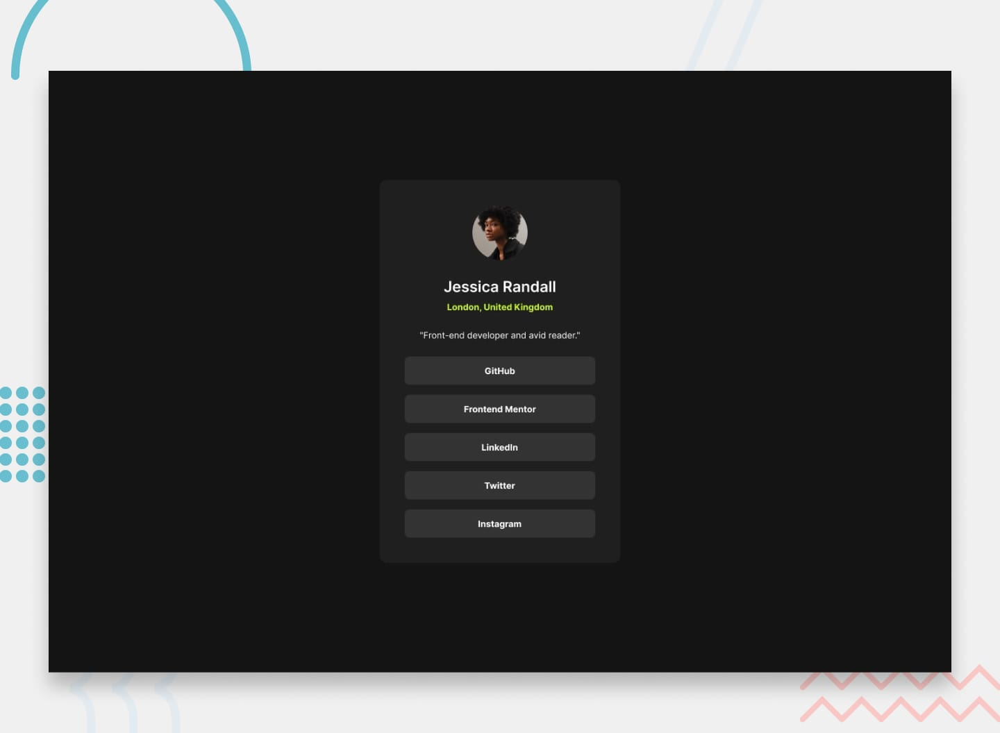

# Perfil de Links Sociais

Este é um projeto desenvolvido como desafio da plataforma [Frontend Mentor](https://www.frontendmentor.io/), com o objetivo de reproduzir um perfil contendo informações pessoais e links para redes sociais, seguindo o layout proposto.

## 📸 Prévia do projeto

## 🛠️ Tecnologias utilizadas

- HTML5
- CSS3 Flexbox
- Google Fonts (Inter)

## 🚀 Desenvolvimento futuro

Pretendo continuar praticando e aprimorando meus conhecimentos em HTML e CSS por meio de novos desafios, dando atenção especial à responsividade, acessibilidade e organização do código.

## 👨‍💻 Autor

- GitHub: [@Dev-jaoo](https://github.com/Dev-jaoo)
- Frontend Mentor: [@Dev-jaoo](https://www.frontendmentor.io/profile/Dev-jaoo)

## 🙏 Agradecimentos

Agradeço à plataforma [Frontend Mentor](https://www.frontendmentor.io/) pela oportunidade de praticar desenvolvimento front-end com desafios baseados em projetos reais.